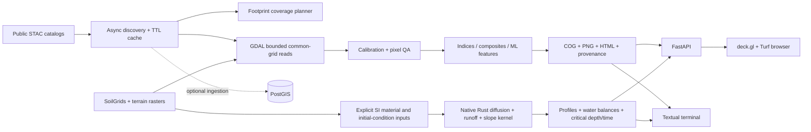

# Architecture

RSLIB has one analysis core and three clients: Python/CLI, a Textual terminal, and a deck.gl browser over FastAPI. The native Rust crate is a separate numerical library with a bounded JSON executable boundary. An installed legacy TRIGRS model is not involved.

Data movement is prioritized over algorithm micro-optimization. Search results are capped, raster reads target the AOI, overviews limit preview resolution, bands are read concurrently with three workers, and the service bounds active analysis to two jobs. GDAL caches have explicit limits; the Rust solver uses Rayon with four threads by default through the Python bridge. These are initial budgets, not measured optimal settings for all hardware or storage regions.

`ResponseCache` stores public unsigned catalog JSON, expires old responses, and caps its entry count. Planetary Computer SAS signing happens immediately before access. The database is optional: scene geometries and JSONB documents go into PostGIS; raster blobs stay outside PostgreSQL. The current catalog keys are collection/item IDs, so ingesting different providers with colliding IDs replaces the existing document; use separate catalogs until provider-aware identities are implemented.

Runs are immutable UUID directories under `data/runs`. They contain a georeferenced COG, PNG preview, printable HTML and a JSON manifest with parameters, selected assets, calibration policy, grid, QA policy, versions, timings and output checksums. The input fingerprint describes the request and resolved metadata, not an independently measured checksum of remote source bytes.

The browser builds into `src/rslib/web`. The Python wheel includes those assets when they exist before packaging. The Rust binary is built separately, copied into the container, or resolved from PATH / `RSLIB_HYDRO_BIN`. Docker provides the same analysis service plus optional PostGIS, with loopback-bound host ports and persistent volumes.

The current API runs analyses as bounded requests in background threads; it is not a durable distributed job system. Process restarts interrupt work. Disk retention, per-user quotas, cancellation of native raster reads, authentication and multi-tenant scheduling belong to the next infrastructure phase.

## Local jobs and evaluation

The browser and TUI submit immutable recipe snapshots to the SQLite job queue. A Unix process lock elects the local worker owner; two worker tasks share the API analysis semaphore. Progress callbacks persist a journal and check cancellation at scene/export boundaries. The exact discovered inventory is saved before raster work. Completed scene caches survive interrupted attempts; unfinished exports remain private until atomic publication. See [the execution contract](JOBS.md) for recovery, cancellation races and deployment limits. FastAPI startup/shutdown uses its documented [lifespan context](https://fastapi.tiangolo.com/advanced/events/).

Temporal validation withholds each complete UTC acquisition day across all sensors. It calls the same gap-limited interpolation routine as preparation, compares a nearest-bracket baseline on paired cells, and keeps unsupported holdouts in the coverage denominator. Input checksums bind scores to the published stack. This diagnoses retrospective reconstruction on clear reference observations; it does not calibrate pixel uncertainty or validate performance under actual cloud occlusion.
