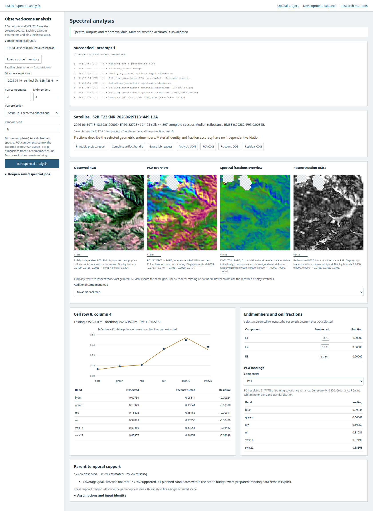

# RSLIB

RSLIB prepares small Sentinel-2 and Landsat datasets for inspection and quantitative analysis. A shared Python core serves a browser workbench, terminal interface and CLI. It uses GDAL for raster access, STAC for discovery, deck.gl and Turf.js for browser interaction, optional PostGIS, and a separate native Rust hydrology engine.

[Install and run](GETTING_STARTED.md){ .md-button .md-button--primary }
[Optical workflow](OPERATIONS.md){ .md-button }

## Current workflows

| Task | Operation and output |
| --- | --- |
| Acquire comparable observations | Bounded STAC discovery, explicit calibration, native QA, projected common grids, partial spectral bandpass adjustment and cached scene preparation |
| Inspect a time series | Observed daily mosaics, bounded interpolation, missing support, exact cell values and source acquisitions |
| Monitor polygon areas | Fractional-cell area statistics, observed/estimated/missing area, fixed observed footprint, CSV and GeoJSON |
| Analyze observed spectra | Queued PCA, VCA and fully constrained least-squares unmixing; component inspection, COG exports and printable reports |
| Resume work | Saved projects, pinned job inventories, cancellation, retry, process-restart recovery and artifact checksums |
| Examine physical scenarios | Independent Rust implementation of documented infiltration and stability equations, with explicit SI-unit inputs and unsupported physics |

*Working browser with actual satellite inputs. Spectral components are exploratory; material fractions have no independent validation.*

## Reference cases and limits

The [reference suite](reference-projects/README.md) retains actual observations across six small sites. Development and holdout roles remain separate, with frozen acquisition inventories and input hashes. The [case viewer](showcase/reference-cases.html) shows retained clear support and missing data. Independent cloud/material labels are still absent.

Ordinary Sentinel-2/Landsat surface reflectance receives partial bandpass adjustment, not the complete HLS harmonization chain. General accuracy, larger-area throughput and site-specific environmental applications remain unvalidated. Read the [capability audit](PRODUCT_AUDIT.md), [scientific contracts](SCIENCE.md) and [validation evidence](VALIDATION.md) before interpreting a result.

## Documentation and the application

This site is static documentation. Run the analysis service locally to acquire data, execute jobs or use the browser/TUI. The [development gallery](showcase/index.html) contains actual captures alongside explicitly labeled synthetic fixtures, hypothetical model scenarios and concept art.

The [roadmap](ROADMAP.md) distinguishes implemented work from proposed milestones. The [research inventory](research/INDEX.md) lists reviewed methods; an entry does not imply an installed adapter.
